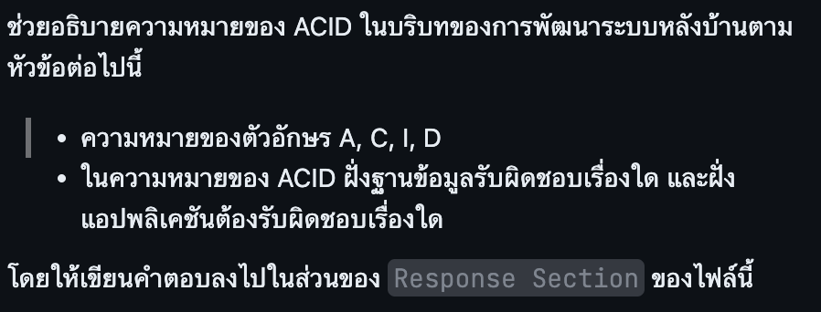

## Question

## Response Section

ในการย้ายนักเรียนระหว่างห้อง ระบบต้องแก้ห้องประจำตัวและบันทึกประวัติการย้ายในธุรกรรมเดียวกัน

- Atomicity ทำให้ทั้งสองรายการสำเร็จพร้อมกัน ถ้าบันทึกประวัติล้มเหลว ฐานข้อมูลย้อนการเปลี่ยนห้องด้วย
- Consistency รักษากฎที่กำหนดไว้ เช่น foreign key บังคับให้ห้องปลายทางมีอยู่จริง ส่วนกฎว่าห้องต้องมีที่ว่างต้องออกแบบในแอปพลิเคชันหรือในฐานข้อมูล
- Isolation กำหนดว่าธุรกรรมที่ทำงานพร้อมกันมองเห็นการเปลี่ยนแปลงของกันและกันอย่างไร หากสองคนจองที่นั่งสุดท้าย แอปต้องเลือกใช้การล็อกแถวของห้อง หรือระดับ serializable พร้อมลองใหม่เมื่อธุรกรรมขัดแย้งกัน
- Durability ทำให้ข้อมูลที่ commit สำเร็จคงอยู่หลังระบบเริ่มใหม่ โดยอาศัยกลไกอย่าง transaction log และการตั้งค่าการบันทึกลงดิสก์

ฐานข้อมูลบังคับ constraints จัดการ commit, rollback และ concurrency ตามระดับ isolation ที่เลือก ฝั่งแอปกำหนดขอบเขตธุรกรรม ตรวจเงื่อนไขทางธุรกิจ และจัดการข้อผิดพลาด หากต้องส่งอีเมลแจ้งย้ายห้อง สามารถเขียน outbox ในธุรกรรมเดียวกันแล้วให้ worker ส่งภายหลัง เพื่อหลีกเลี่ยงการแจ้งผลก่อน commit
