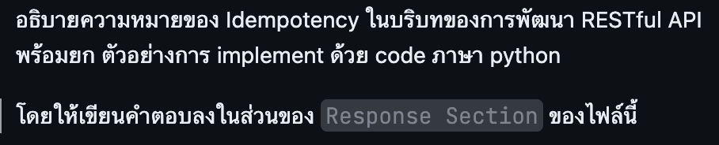

## Question

## Response Section

คำขอที่เป็น idempotent เมื่อส่งซ้ำด้วยข้อมูลเดิม จะให้ผลต่อสถานะที่ต้องการเหมือนส่งครั้งเดียว เช่น เมื่อ client รอผลจนหมดเวลาแล้วส่งคำขอเดิมอีกครั้ง รหัสตอบกลับอาจต่างกันได้ เช่น DELETE ครั้งแรกได้ 204 และครั้งถัดไปได้ 404 โดยทรัพยากรยังคงถูกลบ

ตัวอย่าง Django REST Framework สำหรับ PUT ที่แก้ที่อยู่โรงเรียนที่มีอยู่แล้ว

```python
from django.shortcuts import get_object_or_404
from rest_framework import serializers
from rest_framework.decorators import api_view
from rest_framework.response import Response
from apis.models import School


class AddressSerializer(serializers.Serializer):
    address = serializers.CharField()


@api_view(["PUT"])
def school_address(request, pk):
    payload = AddressSerializer(data=request.data)
    payload.is_valid(raise_exception=True)
    school = get_object_or_404(School, pk=pk)
    school.address = payload.validated_data["address"]
    school.save(update_fields=["address"])
    return Response({"address": school.address})
```

การส่งที่อยู่เดิมสองครั้งยังได้โรงเรียนหนึ่งรายการที่มีที่อยู่นั้น สำหรับ POST ที่สร้างรายการ เช่น การเรียกเก็บเงิน สามารถใช้ idempotency key ที่ไม่ซ้ำต่อผู้ใช้ บันทึก key ลายนิ้วมือของ payload และผลลัพธ์พร้อมธุรกรรม แล้วคืนผลเดิมเมื่อ retry ด้วยข้อมูลเดิม หาก key เดิมมากับข้อมูลต่างกันให้แจ้ง conflict
